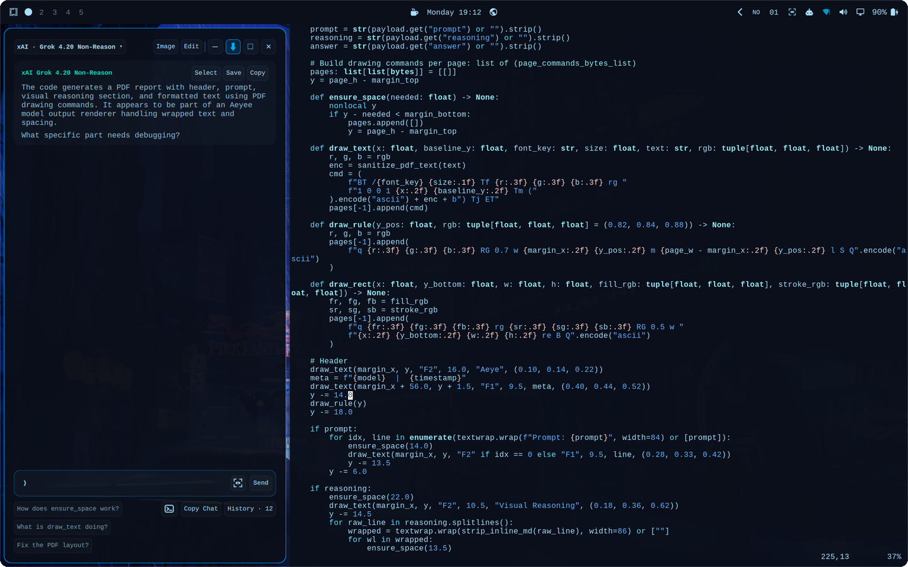
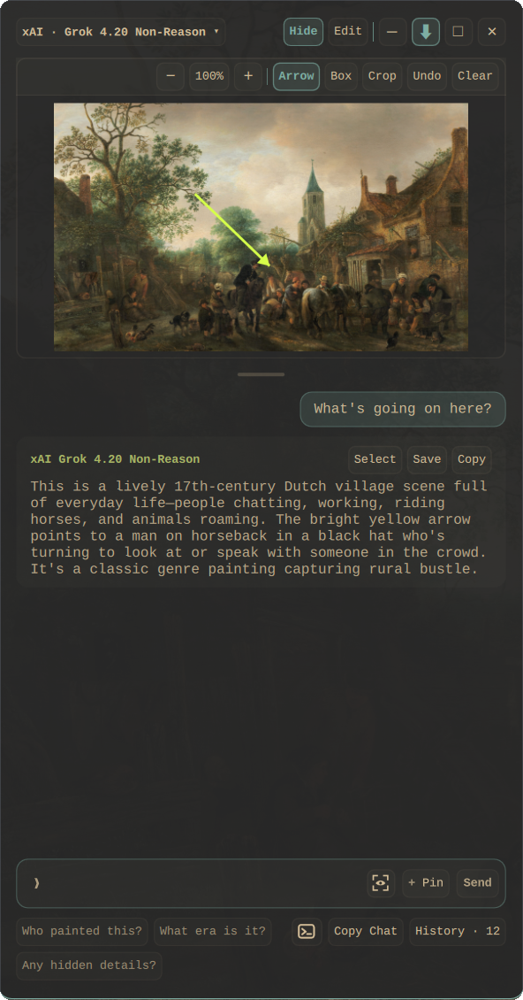
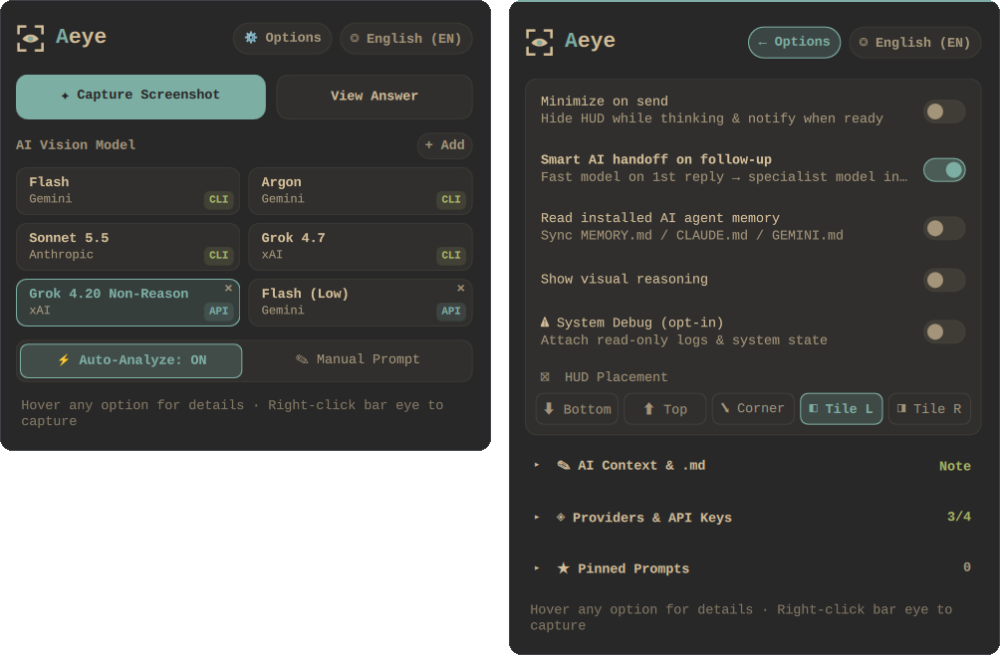

<p align="center">
  <picture>
    <source media="(prefers-color-scheme: dark)" srcset="wordmark-dark.svg?v=4" />
    <source media="(prefers-color-scheme: light)" srcset="wordmark-light.svg?v=4" />
    
  </picture>
</p>

<p align="center">
  Screenshot, point with an arrow, and ask AI — natively inside <a href="https://omarchy.org">Omarchy</a>.
</p>

<p align="center">
  
  <a href="LICENSE"></a>
  <a href="https://github.com/7eleven77/Aeye/releases"></a>
</p>

<p align="center">
  
</p>

- **Point & ask:** Zoom up to 400%, draw an arrow, box, or crop directly in the HUD, and just type *"this one"*.
- **Smart model handoff:** Fast vision model on turn 1, automatically hands off to your stronger model on follow-up.
- **Keep your Pro subscription:** Toggle `CLI` (`agy`, `claude`, `grok`) vs. direct `API` per provider or per model so you don't burn API credits unnecessarily.
- **Native Hyprland tiling:** Float click-through (`Bottom`, `Top`, `Corner`) or snap into `Tile L` / `Tile R` (`exclusiveZone`) with zero window overlap.
- **Export & redact:** 1-click export (`.md`, `.pdf`, `.txt`, `.html`, `.json`) and Omasnap blur/redaction before sending.

---

## Install

```sh
omarchy plugin add https://github.com/7eleven77/Aeye.git --enable
```

Update anytime:

```sh
omarchy plugin update io.github.7eleven77.aeye
```

Right-click the top-bar eye icon to capture (left-click to open the Control Hub). To bind a global Hyprland shortcut, add one line to `~/.config/hypr/bindings.lua`:

```lua
o.bind("SUPER + SHIFT + PRINT", "Aeye", os.getenv("HOME") .. "/.config/omarchy/plugins/io.github.7eleven77.aeye/bin/aeye capture")
```

<details>
<summary>Local development link &amp; uninstall</summary>

```sh
# Link local checkout
ln -sfn "$PWD" "$HOME/.config/omarchy/plugins/io.github.7eleven77.aeye"
omarchy plugin enable io.github.7eleven77.aeye
omarchy restart shell

# Run offline verification suite (25 checks)
./tests/smoke.sh

# Uninstall
omarchy plugin remove io.github.7eleven77.aeye
rm -f ~/.config/omarchy/aeye.json ~/.config/omarchy/aeye-keys.json
```

</details>

---

## Usage & Keybinds

| Action | How |
|---|---|
| **Capture screenshot** | Right-click top-bar eye · or <kbd>Super</kbd>+<kbd>Shift</kbd>+<kbd>Print</kbd> |
| **Open Control Hub** | Left-click top-bar eye (switch between Main Hub & `⚙ Options`) |
| **Attach another screenshot** | Click the eye icon inside the right side of the chat input bar |
| **Switch model inline** | Click the model pill (`Provider · Model ▾`) top-left (right-click to cycle) |
| **Zoom, draw, pan & crop** | `-` `100%` `+`, `Arrow`, `Box`, `Crop`, `Undo` above preview · right-drag or `Pan` to move · `Crop` auto-applies on Send |
| **Redact sensitive info** | Click `Edit` top-right to blur/pixelate in Omasnap before sending |
| **Move / tile / fullscreen** | Click `◧` (placement) or `□` (Fullscreen, also from `Tile L` / `Tile R`) top-right |
| **Copy replies** | `Copy` or `Select` on AI replies · `Copy Chat` / `Copy Selected · N` below input bar |
| **Hand off to CLI agent** | Click the `>_` terminal button below the input bar to open `omarchy-agent` with context |
| **Session history** | Click `History · N` below the input bar to reopen any of the last 12 threads |
| **Export answer** | Click `Save` on the answer card (`.pdf`, `.md`, `.txt`, `.html`, `.json`) |
| **Close / dismiss** | <kbd>Esc</kbd> |

---

## Screenshots

### Inline Arrow Annotation
<p align="center">
  
</p>

### Control Hub (`CLI` vs. `API` Auth & Options)
<p align="center">
  
</p>

---

## Configuration, Models & Security

<details>
<summary>Supported providers &amp; live model discovery</summary>

Aeye automatically detects existing Omarchy CLI auth (`agy`, `claude`, `grok`) and lets you switch between `CLI` and direct `API` per provider or per model card. Click `+ Add` in the Main Hub to discover 36+ vision models across all four providers:

| Provider | Examples | Auth |
|---|---|---|
| **Google Gemini** | `Flash 3.8`, `Argon 4`, `Neon 4`, `Gemini 2.5 Pro/Flash` | `CLI` (`agy`) · `API` (`GEMINI_API_KEY` / manual) |
| **Anthropic Claude** | `Sonnet 5.5`, `Opus 5.5`, `Opus 5.6`, `Haiku 5.5` | `CLI` (`agy` / `claude`) · `API` (`ANTHROPIC_API_KEY` / manual) |
| **xAI Grok** | `Grok 4.7`, `Grok 4.20 Non-Reasoning / Reasoning / Multi-Agent` | `CLI` (`grok`) · `API` (`XAI_API_KEY` / manual) |
| **OpenAI** | `GPT-4o`, `GPT-4.1`, `GPT-4.1 Mini`, `o4-mini`, `o3` | `API` (`OPENAI_API_KEY` / manual) |

</details>

<details>
<summary>Control Hub options &amp; persistent .md context</summary>

- **Auto-Analyze vs. Manual Prompt:** Toggle in the Main Hub whether captures analyze immediately or wait for your prompt.
- **Smart AI handoff on follow-up:** Uses a fast model for turn 1 and hands off to your strongest ready model for follow-ups.
- **AI Context & `.md`:** Add a persistent instruction note or link a Markdown file (e.g. `~/Documents/aeye-context.md`) opened directly in `$EDITOR`.
- **CLI Agent Memory (opt-in):** Off by default. Optionally syncs curated `MEMORY.md`, `CLAUDE.md`, and `GEMINI.md` read-only.
- **Pinned Prompts:** Type any prompt in the HUD and click `+ Pin` to save it as a 1-click chip (right-click a chip to remove).

</details>

<details>
<summary>Security, privacy &amp; opt-in System Debug</summary>

- **Isolated `0700` runtime sandbox:** Each request copies only `shot.png` (and `sysdebug.txt` if enabled) into a private `0700` dir under `$XDG_RUNTIME_DIR/aeye` — models never execute inside `$HOME`.
- **Key storage & redaction:** Manual keys are stored with `chmod 600` in `~/.config/omarchy/aeye-keys.json`. Tokens (`sk-*`, `xai-*`, `AIza*`, `Bearer *`) are redacted from previews, and `.md` loading blocks sensitive paths (`.ssh`, `.gnupg`, `.env`, `aeye-keys.json`).
- **Opt-in read-only System Debug:** Off by default. When enabled in `⚙ Options`, attaches a bounded (~8 KB) read-only snapshot (`uname`, `hyprctl`, recent unprivileged `journalctl` errors, `free`/`df`) and highlights the `>_` terminal button. Runs strictly unprivileged, never dumps env vars, and never executes commands automatically.

</details>

---

## License

MIT — see [LICENSE](LICENSE).
