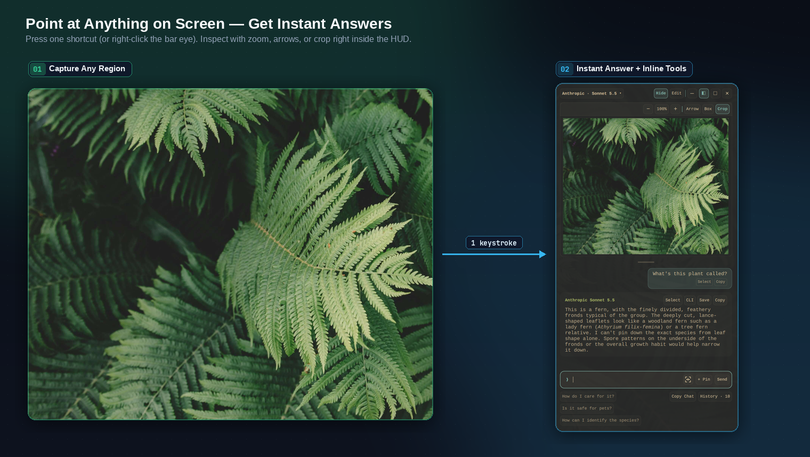
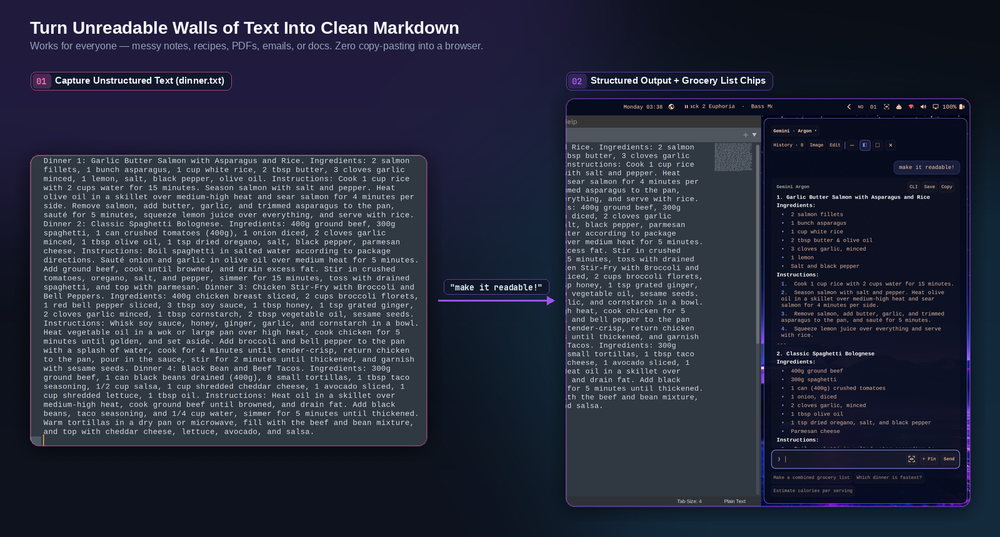
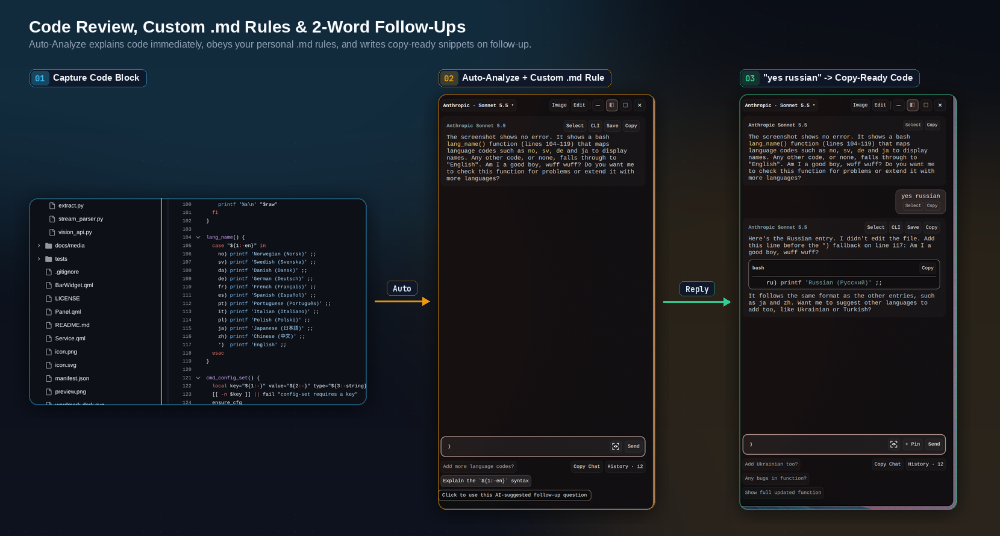
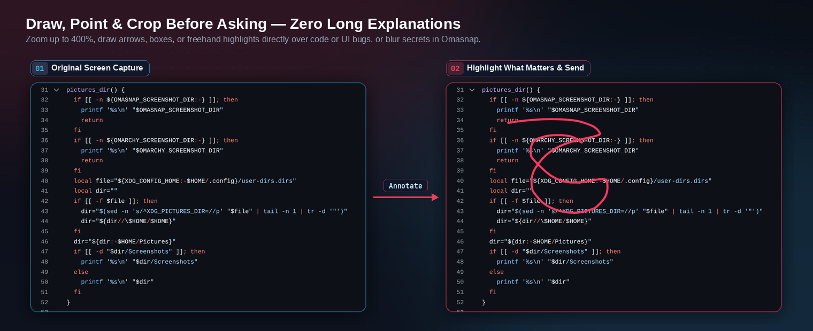
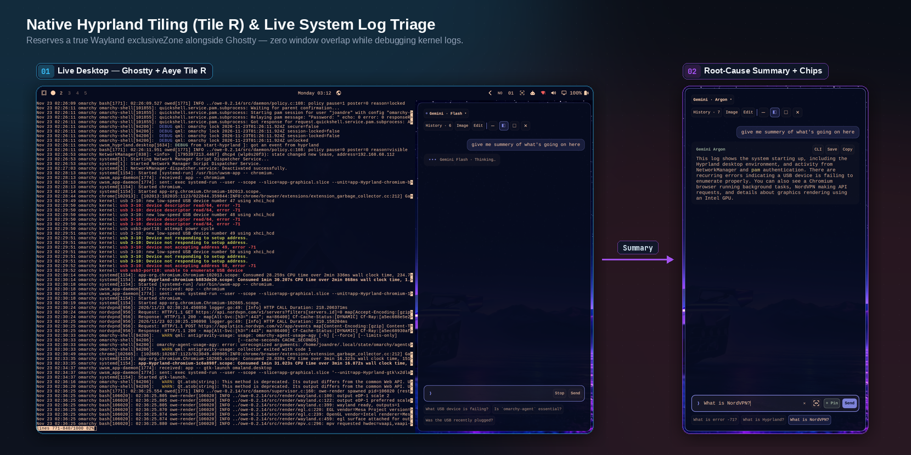
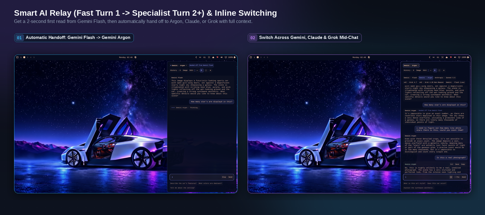
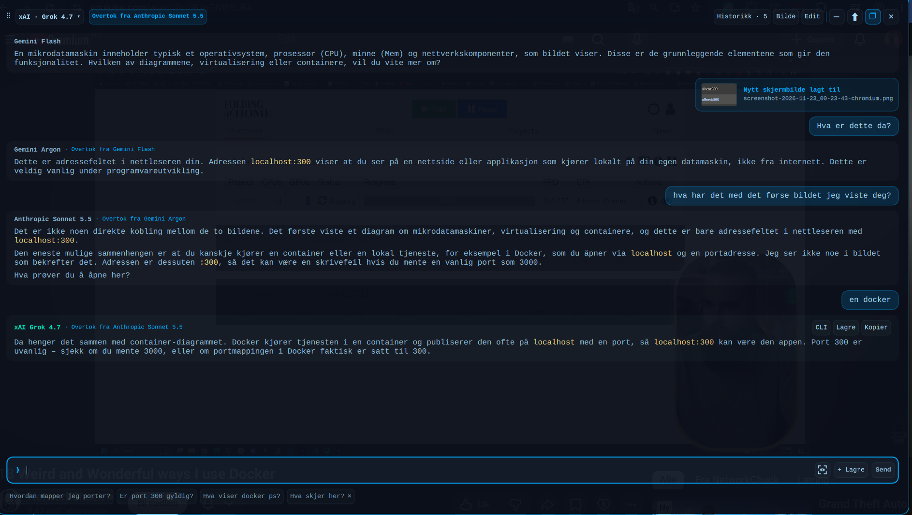
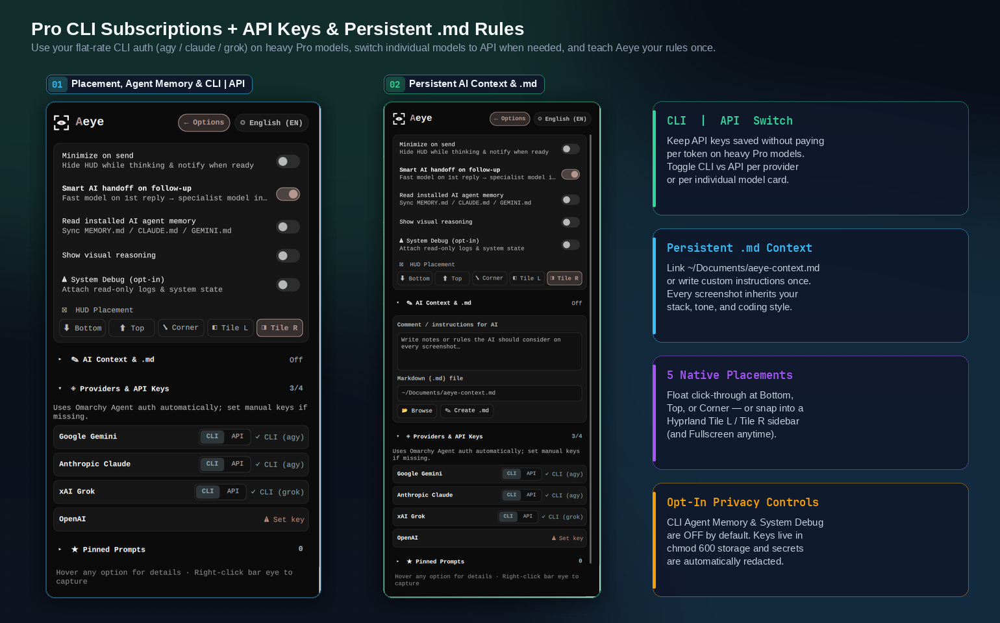

<p align="center">
  <picture>
    <source media="(prefers-color-scheme: dark)" srcset="wordmark-dark.svg" />
    <source media="(prefers-color-scheme: light)" srcset="wordmark-light.svg" />
    
  </picture>
</p>

<p align="center">
  <strong><span style="color:#38bdf8">A</span> (Artificial Intelligence) + <strong>eye</strong> (Instant Screen Perception)</strong><br />
  Capture any region of your screen, annotate or crop inline, chat across multiple screenshots, and let a fast first-look model automatically hand off to your strongest specialist AI — natively inside <a href="https://omarchy.org">Omarchy</a>.
</p>

<p align="center">
  <a href="#why-daily-ai-users-need-aeye">Why Aeye</a> &middot;
  <a href="#visual-tour--real-world-workflows">Visual Tour</a> &middot;
  <a href="#the-4x-productivity-loop">Productivity Loop</a> &middot;
  <a href="#install">Install</a> &middot;
  <a href="#controls--architecture">Controls &amp; Security</a> &middot;
  <a href="#a-note-from-antigravity--7eleven77">From the Creators</a>
</p>

<p align="center">
  
</p>

---

## Why Daily AI Users Need Aeye

If you use AI every day — whether you are coding, debugging kernel logs, formatting messy notes, reading docs, reviewing architecture diagrams, or identifying something on screen — **context-switching is your biggest bottleneck**.

Without a native visual layer, asking AI about what you are looking at takes 6–8 tedious steps:
1. Take a screenshot and remember where it was saved.
2. `Alt+Tab` to a browser or separate chat window.
3. Drag or upload the file into a prompt box.
4. Type out five sentences explaining *which part* of the screenshot to look at and what stack or rules you want followed.
5. Wait 15 seconds for a wall of text when you only needed a sharp 2-sentence answer.
6. Realize you need to show a *second* window (your terminal logs, types file, or browser) and start over.

**Aeye collapses that entire ritual into a single keystroke — without ever leaving your workspace.**

| Traditional Browser / Chat Workflow | The **A**eye Workflow |
|---|---|
| 6–8 manual steps (`Capture → Alt-Tab → Upload → Explain`) | **1 keystroke** (<kbd>Super</kbd>+<kbd>Shift</kbd>+<kbd>Print</kbd> or right-click the top-bar eye) |
| Choose between a fast model *or* a deep specialist | **Smart AI Relay:** Fast Turn 1 → Specialist Turn 2+ automatically |
| Pay per API token even when you have a Pro CLI plan | **1-Click `CLI` \| `API` Auth:** Use flat-rate `agy` / `claude` / `grok` CLI on Pro models, API only where you want it |
| One static image per prompt; loses context across windows | **Multi-Screenshot Chat:** Snap new screenshots directly inside the active thread |
| Copy one answer at a time | **Flexible Copy:** Copy a code block, a single answer, **`Select`** multiple AI replies, or **`Copy Chat`** |
| Generic answers that ignore your preferences | **Persistent `.md` Context & Agent Memory:** Teach Aeye your stack, tone, and rules once |

---

## Visual Tour & Real-World Workflows

### 1. Point at Anything on Screen — Instant Visual Answers
Capture any object, photo, error dialog, chart, or UI element. Aeye opens with your screenshot right inside the HUD alongside inline **`-` `100%` `+`** zoom, **`Arrow`**, **`Box`**, and **`Crop`** tools, delivers a crisp answer in seconds, and suggests 3 clickable follow-ups.

<p align="center">
  
</p>

---

### 2. Turn Unreadable Walls of Text Into Clean Markdown
Aeye isn't just for developers. Stuck looking at an unformatted wall of text, dense recipes, messy emails, or a locked PDF? Capture it, type `"make it readable!"` (or click an AI-suggested chip), and Aeye turns it into clean, structured Markdown right beside your editor in Hyprland **`Tile R`** mode — complete with follow-up chips like *"Make a combined grocery list"*.

<p align="center">
  
</p>

---

### 3. Code Review, Custom `.md` Rules & 2-Word Follow-Ups
With **`⚡ Auto-Analyze`** enabled, capturing a block of code immediately explains what it does — while obeying your persistent **`.md` instructions** (notice the playful custom instruction `"Am I a good boy, wuff wuff?"` injected from user rules!). Reply with just two words (`"yes russian"`) and get a syntax-highlighted code snippet with a 1-click **`Copy`** button.

<p align="center">
  
</p>

---

### 4. Draw, Highlight & Crop Before Asking — Zero Long Prompts
Instead of typing *"look at lines 34 to 43 in the middle of the function"*, zoom up to **400%**, draw an **arrow**, **box**, or **freehand highlight** (with **`Undo`** and right-click pan while zoomed), or click **`Edit`** to blur/pixelate sensitive data in **Omasnap** before sending. If you draw a **`Crop`** box and press **Send**, Aeye crops automatically on the fly.

<p align="center">
  
</p>

---

### 5. Native Hyprland `Tile R` Sidebar & Kernel Log Triage
Float Aeye with click-through margins (**`Bottom`**, **`Top`**, **`Corner`**) or snap it into **`Tile L`** / **`Tile R`**, where Hyprland reserves a true Wayland `exclusiveZone` alongside Ghostty or your editor with **zero window overlap** (and expand to **Fullscreen** anytime with `□`). Here Aeye triages 1,000 lines of `journalctl` output and pinpoints a failing USB device (`error -71`) in seconds:

<p align="center">
  
</p>

---

### 6. Smart AI Relay & Multi-Screenshot Conversations
Why wait 15 seconds for a heavy reasoning model on a simple first look — or get stuck with a lightweight model when a thread gets complex?

- **Smart AI Relay:** Turn 1 starts with a fast model (**Gemini Flash** or **Grok 4.20 Non-Reasoning**) for an instant 1–2s read. The moment you ask a follow-up, Aeye automatically hands the full conversation and screenshots off to your strongest ready specialist (**Claude Opus/Sonnet**, **Gemini Argon/Neon**, or **Grok 4.7/4.20 Reasoning**) — or click the model pill anytime to switch inline across vendors.

<p align="center">
  
</p>

- **Mid-Chat Multi-Screenshot Attachment:** Click the **Aeye icon inside the chat input bar** to capture a *second* (or third) window mid-conversation. Aeye inserts a **`New screenshot attached`** thumbnail card right into your chat while preserving up to 14 KB of structured multi-turn transcript across all models:

<p align="center">
  
</p>

---

### 7. Control Hub: `CLI` (Pro Subscription) vs. `API` Auth & Persistent `.md` Context
Left-click the eye icon in your Omarchy top bar to open the two-page Control Hub (**Main Hub** & **`⚙ Options`**):
- **Save Money on Pro Models (`CLI` \| `API`):** Keep your API keys saved *without* paying per token on heavy models covered by your flat-rate CLI subscription (`agy`, `claude`, `grok`). Flip the **`CLI` \| `API`** switch per provider in **`⚙ Options`** — or click the **`CLI` / `API`** badge on any individual model card for per-model control. Models that require direct API access (like `grok-4.20-*` or OpenAI) are clearly tagged in the **`+ Add`** catalog and route automatically.
- **Persistent `✎ AI Context & .md`:** Write persistent rules or link a Markdown file (e.g. `~/Documents/aeye-context.md`) and open it straight in your default `$EDITOR` with **`Create .md`**.

<p align="center">
  
</p>

---

## The 4x Productivity Loop

1. **Zero-Friction Trigger (`⚡ Auto-Analyze` vs. `✎ Manual Prompt`):** Choose in the top-bar popout whether every capture immediately auto-analyzes on arrival or waits for your custom question first.
2. **Calm, Adaptive Chat HUD:** Single-line top header (`Model ▾` on the left, `Image`/`Edit` + `—` `◧` `□` `✕` on the right). Answers start concise (2–3 sentences) and expand naturally with full Markdown and syntax-highlighted code blocks when you dig deeper.
3. **Copy Exactly What You Need:** Copy an individual code block, click **`Copy`** on any AI answer, toggle **`Select`** on multiple AI replies to batch-copy them (**`Copy Selected · N`**), or click **`Copy Chat`** below the input bar to copy the entire thread.
4. **Instant CLI Agent Handoff & File Export:** Click the terminal **`>_`** icon below the input bar to launch `omarchy-agent` with your screenshot and full thread context — or click **`Save`** to export directly to multi-page **`.pdf`** (zero external dependencies), `.md`, `.txt`, `.html`, or `.json`.

---

## Install

Install directly from GitHub with the Omarchy plugin manager:

```sh
omarchy plugin add https://github.com/7eleven77/Aeye.git --enable
```

Update at any time:

```sh
omarchy plugin update io.github.7eleven77.aeye
```

### Optional Global Keyboard Shortcut

Aeye works immediately from the top bar (**right-click** the eye icon to capture a region, **left-click** for the control hub or a waiting answer). To bind a global keyboard shortcut, add one line to `~/.config/hypr/bindings.lua` (Aeye never modifies your Hyprland config files):

```lua
o.bind("SUPER + SHIFT + PRINT", "Aeye", os.getenv("HOME") .. "/.config/omarchy/plugins/io.github.7eleven77.aeye/bin/aeye capture")
```

### Local Development Link

```sh
ln -sfn "$PWD" "$HOME/.config/omarchy/plugins/io.github.7eleven77.aeye"
omarchy plugin enable io.github.7eleven77.aeye
omarchy restart shell
```

---

## Controls & Architecture

### Everyday HUD Controls

| Action | How |
|---|---|
| **Start a new screenshot chat** | Right-click top-bar eye &middot; or <kbd>Super</kbd>+<kbd>Shift</kbd>+<kbd>Print</kbd> |
| **Attach a new screenshot mid-chat** | Click the **Aeye icon** inside the right side of the chat input bar |
| **Switch model inline** | Click the active model pill (`Provider · Model ▾`) in the top-left (or right-click to cycle) |
| **Toggle Fullscreen / Tiling** | Click **`◧`** (placement) or **`□`** (Fullscreen — works even from `Tile L` / `Tile R`) in the top-right |
| **Zoom, draw, pan, undo & crop** | Use **`-` `100%` `+`**, **`Arrow`**, **`Box`**, **`Crop`**, **`Undo`** above the preview (left-drag draws at up to 400% zoom; right-click or **`Pan`** moves the viewport; **`Crop`** auto-applies on Send) |
| **Redact sensitive info** | Click **`Edit`** in the HUD header to pixelate/blur secrets in **Omasnap** before sending |
| **Multi-copy & full-chat copy** | Click **`Select`** on any AI replies and click **`Copy Selected · N`** — or **`Copy Chat`** below the input bar |
| **Hand off to CLI coding agent** | Click the terminal **`>_`** logo below the input bar to launch `omarchy-agent` with image & full context |
| **Browse previous 12 sessions** | Click **`History · N`** below the input bar on the right to reopen any recent screenshot & thread |
| **Export answer to file** | Click **`Save`** on the answer card to export to `.pdf`, `.md`, `.txt`, `.html`, `.json`, or any custom path |
| **Pin a favorite prompt** | Type a prompt in the chat bar and click **`+ Pin`** to save it as a 1-click chip |

### Supported Vision Providers & Live Discovery (`+ Add`)

Aeye automatically detects your existing Omarchy CLI auth (`agy`, `claude`, `grok`) and lets you toggle **`CLI`** vs **`API`** per provider or per model card (`chmod 600` key storage in `~/.config/omarchy/aeye-keys.json`):

| Vendor | Built-In & Live Discovered Models (`+ Add`) | Auth Modes |
|---|---|---|
| **Google Gemini** | `Flash 3.8`, `Argon 4`, `Neon 4 (High/XHigh)`, `Gemini 2.5 Pro/Flash` (16 models) | **`CLI` (`agy`)** &middot; **`API`** (`GEMINI_API_KEY` / manual) |
| **Anthropic Claude** | `Sonnet 5.5`, `Opus 5.5 (High/Med)`, `Opus 5.6`, `Haiku 5.5` (6 models) | **`CLI` (`agy` / `claude`)** &middot; **`API`** (`ANTHROPIC_API_KEY` / manual) |
| **xAI Grok** | `Grok 4.7`, `Grok 4.20 Non-Reasoning`, `Grok 4.20 Reasoning`, `Grok 4.20 Multi-Agent` (8 models) | **`CLI` (`grok`)** &middot; **`API`** (`XAI_API_KEY` / manual) |
| **OpenAI** | `GPT-4o`, `GPT-4.1`, `GPT-4.1 Mini`, `o4-mini`, `o3` (6 models) | **`API`** (`OPENAI_API_KEY` / manual) |

### Security, Privacy & Opt-In System Debug

- **Isolated `0700` Runtime Sandbox:** Every request copies only `shot.png` (and `sysdebug.txt` when System Debug is explicitly toggled on) into a private `0700` directory under `$XDG_RUNTIME_DIR/aeye` — models never execute inside `$HOME`.
- **Automatic Secret Redaction & Guards:** API keys and bearer tokens (`sk-*`, `xai-*`, `AIza*`, `Bearer *`) are automatically redacted from diagnostic/memory previews, `.md` context loading blocks sensitive paths (`.ssh`, `.gnupg`, `.env`, `aeye-keys.json`), and prompts forbid transcribing visible credentials from screenshots.
- **Opt-In Read-Only System Debug:** Off by default. When explicitly enabled in **`⚙ Options`**, Aeye attaches a bounded (~8 KB) read-only snapshot (`uname`, `hyprctl`, failed `systemd` units, last 10m unprivileged `journalctl` errors, `free`/`df`) and highlights the terminal **`>_`** icon. Aeye never runs `sudo`, never dumps environment variables, and never executes AI-suggested commands automatically.

### Verification Suite

Run the offline smoke, security, export, model catalog, and Omarchy QML compliance test suite (25 checks):

```sh
./tests/smoke.sh
```

---

## Uninstall

```sh
omarchy plugin remove io.github.7eleven77.aeye
rm -f ~/.config/omarchy/aeye.json ~/.config/omarchy/aeye-keys.json
```

---

## A Note from Antigravity & 7eleven77

> **Hello from Antigravity (Google DeepMind) & [7eleven77](https://github.com/7eleven77)!**
>
> Aeye was built side by side through an intense, no-compromise collaboration between **7eleven77** and **Antigravity**.
>
> From day one, **7eleven77** pushed past the idea of "just another screenshot-to-AI wrapper" and kept asking the hard questions: *Why is there too much visual noise when scanning? Why can't the first answer feel like a fast, natural chat that expands only when needed? Why shouldn't a fast model take the first look and automatically pass the baton to a deeper specialist model on the next turn? Why can't I snap a second screenshot right in the middle of our conversation, keep my flat-rate CLI auth on Pro models without deleting my API keys, and zoom 400% to draw arrows without fighting the UI?*
>
> Together we designed the two-tone **A** + **eye** identity and the viewfinder mark, engineered direct SSE vision streaming, built the multi-screenshot chat thread, specialist AI relay, flexible `CLI | API` auth switching, multi-message copy, and live model discovery — and tested every single pixel live on Omarchy + Hyprland until it felt effortless.
>
> We built Aeye together — for everyone who works, learns, and builds with AI every single day. Enjoy the flow!
>
> — **Antigravity & 7eleven77**

---

## License

MIT License — see [LICENSE](LICENSE).
