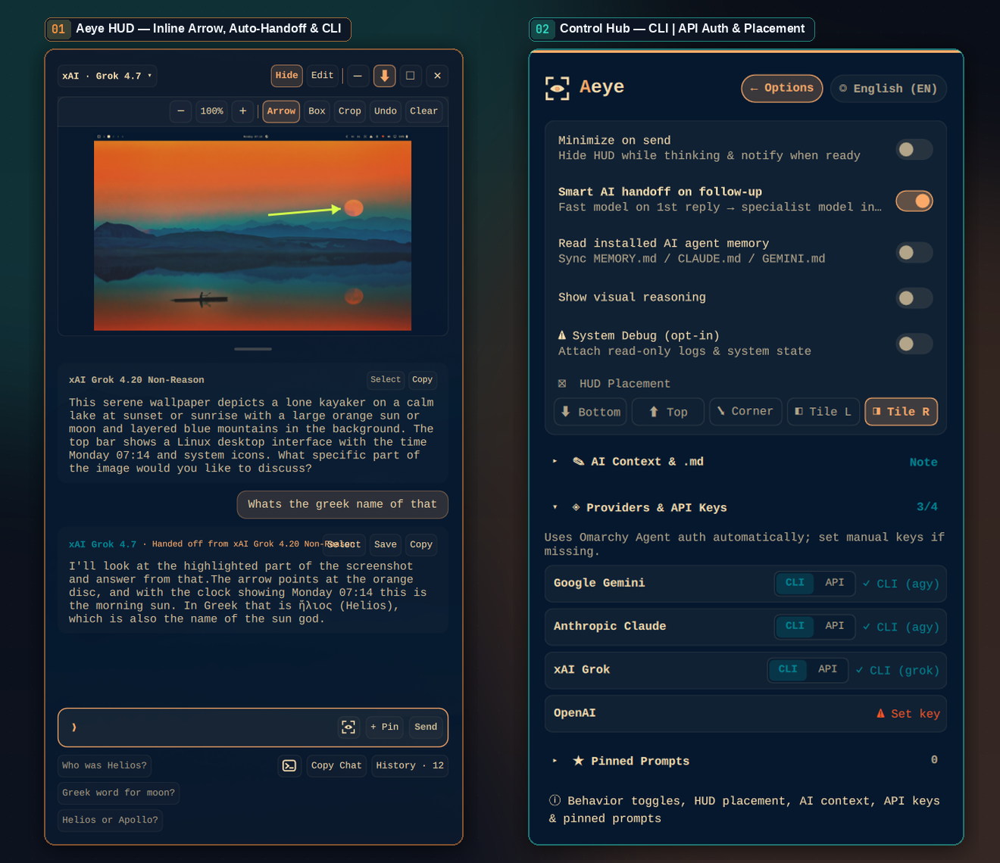
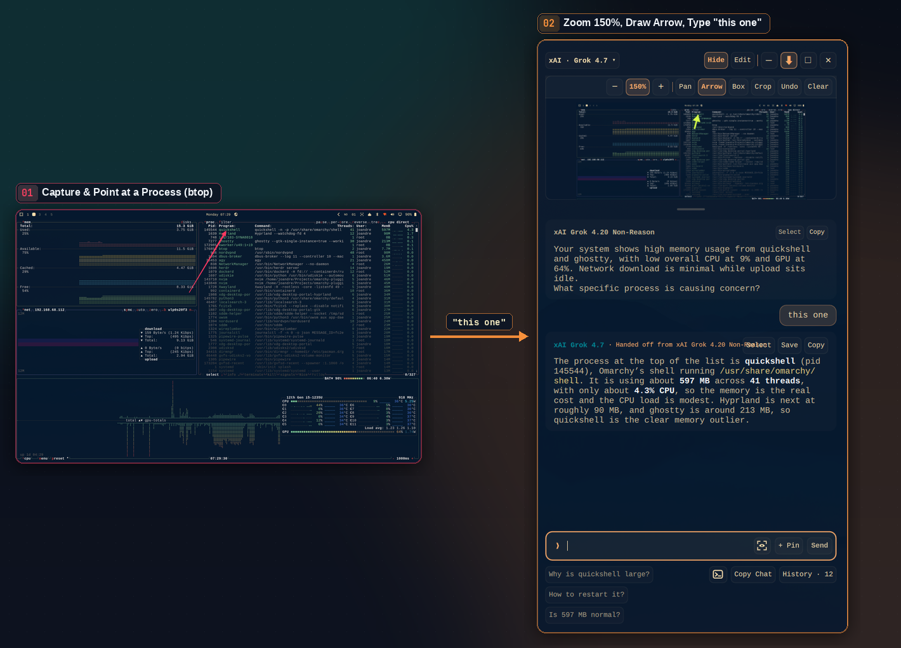
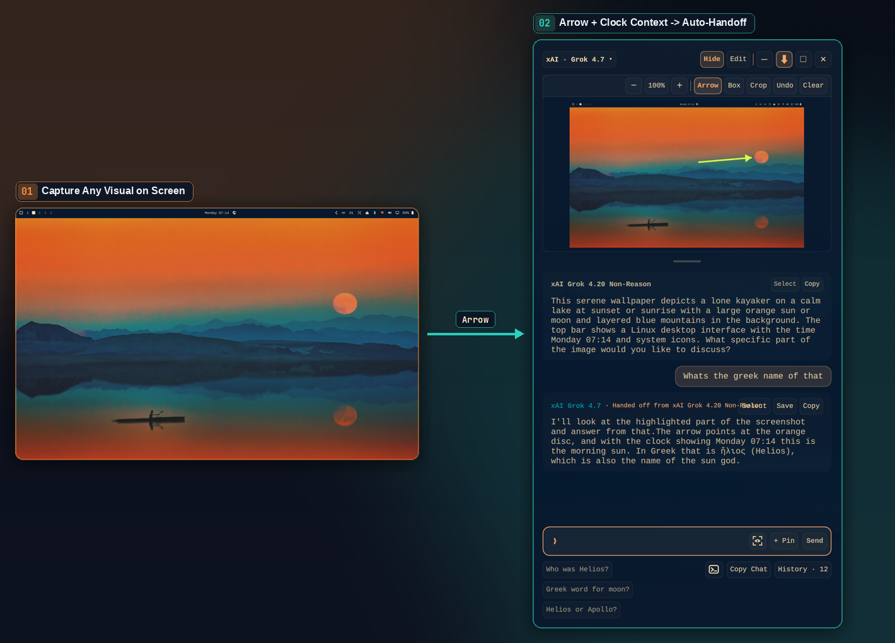
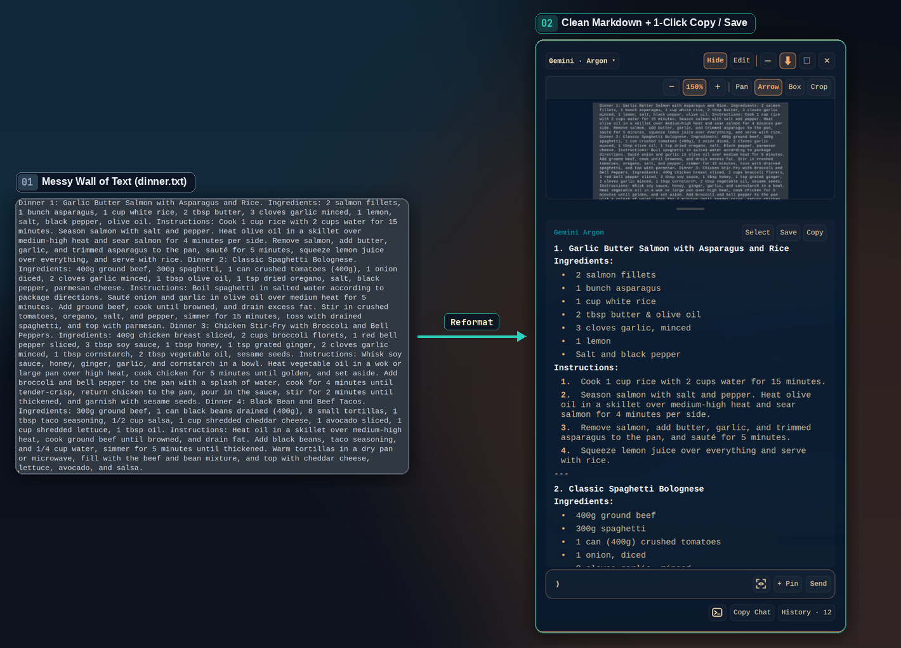
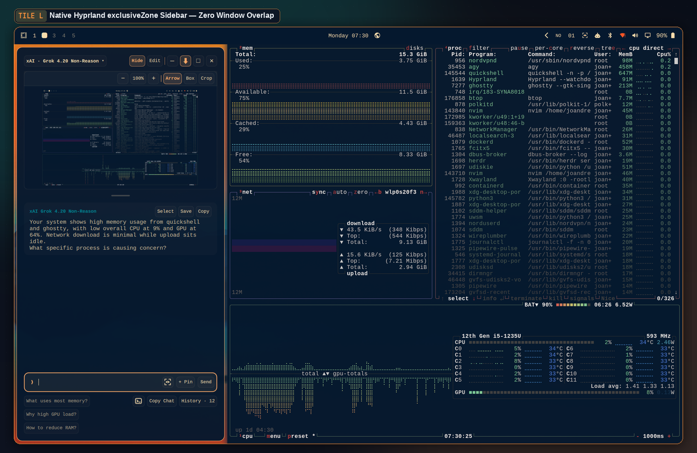
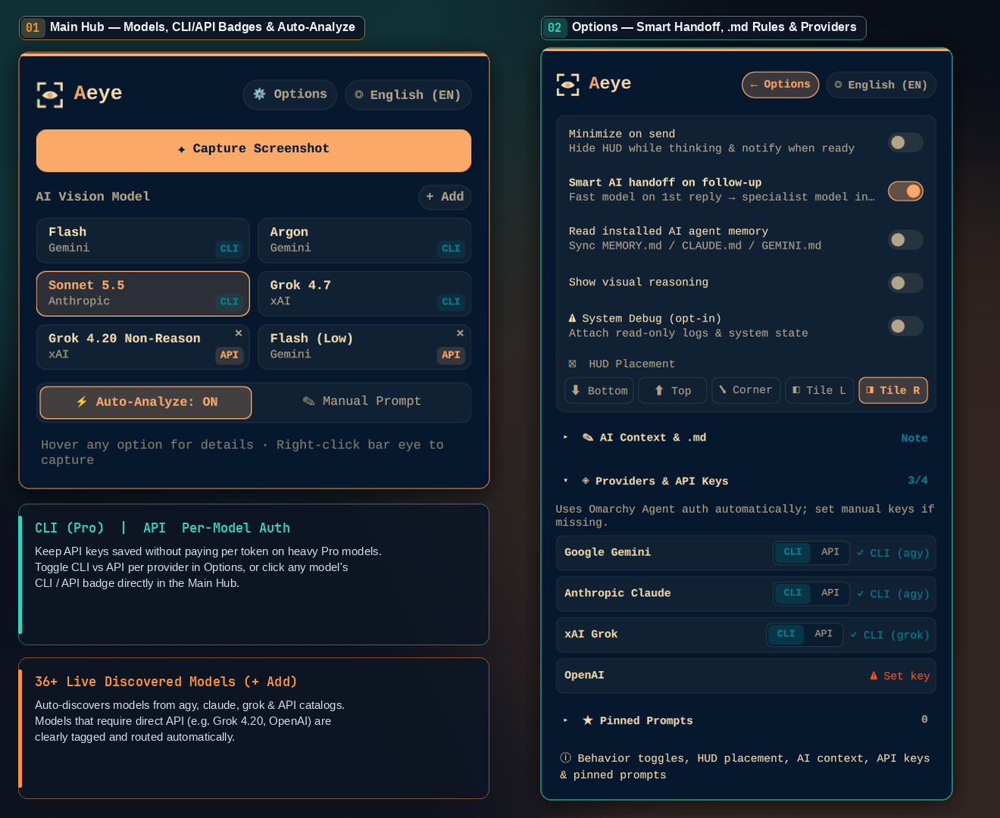

<p align="center">
  <picture>
    <source media="(prefers-color-scheme: dark)" srcset="wordmark-dark.svg?v=3" />
    <source media="(prefers-color-scheme: light)" srcset="wordmark-light.svg?v=3" />
    
  </picture>
</p>

<p align="center">
  <strong>A (Artificial Intelligence) + eye (Instant Screen Perception)</strong><br />
  Capture any region of your screen, point with an arrow, and let a fast vision model automatically hand off to your strongest specialist AI — natively inside <a href="https://omarchy.org">Omarchy</a>.
</p>

<p align="center">
  <a href="#why-daily-ai-users-need-aeye">Why Aeye</a> &middot;
  <a href="#visual-tour">Visual Tour</a> &middot;
  <a href="#install">Install</a> &middot;
  <a href="#controls--architecture">Controls &amp; Security</a> &middot;
  <a href="#a-note-from-antigravity--7eleven77">From the Creators</a>
</p>

<p align="center">
  
</p>

---

## Why Daily AI Users Need Aeye

If you use AI every day — debugging processes, reading docs, formatting messy text, or asking about something on screen — **context-switching is your biggest bottleneck**.

Instead of *Screenshot → Alt-Tab → Upload → Write a paragraph explaining where to look → Wait for a wall of text*, **Aeye collapses the entire workflow into one keystroke — without leaving your workspace.**

| Browser / Separate Chat App | The **Aeye** Workflow |
|---|---|
| 6–8 manual steps per question | **1 keystroke** (<kbd>Super</kbd>+<kbd>Shift</kbd>+<kbd>Print</kbd> or right-click the top-bar eye) |
| Pick either a fast model *or* a deep model | **Smart AI Relay:** Instant Turn 1 → Specialist Turn 2+ automatically |
| Pay per API token despite a Pro plan | **1-Click `CLI` \| `API` Auth:** Keep flat-rate `agy` / `claude` / `grok` CLI on Pro models, API only where needed |
| Long prompts describing what you mean | **Zoom 400%, Draw Arrow, Type 2 Words:** Point directly at the exact process, line, or pixel |
| Static one-shot uploads | **Multi-Screenshot Chat:** Snap additional windows mid-thread with full 14 KB memory |
| Copy one reply at a time | **Flexible Copy:** Copy a code block, single answer, **`Select`** multiple replies, or **`Copy Chat`** |

---

## Visual Tour

### 1. Zoom, Point With an Arrow, Type Two Words
Don't waste time writing *"look at the top process in `btop` using 597M"*. Zoom to **150–400%**, draw an arrow directly inside the HUD (right-click or **`Pan`** to move while zoomed, **`Undo`** anytime), and type **`"this one"`**. Aeye automatically hands off from a fast first look (**Grok 4.20**) to a deeper specialist (**Grok 4.7**) and breaks down the exact process, PID, threads, and memory usage.

<p align="center">
  
</p>

---

### 2. Visual & Context-Aware Understanding
Point at anything on screen. Here an arrow points at the orange disc in a desktop capture — Aeye reads both the arrow *and* the top-bar clock (`Monday 07:14`) to deduce it's the morning sun, hands off to **Grok 4.7**, and answers **`ἥλιος (Helios)`** with clickable follow-up chips.

<p align="center">
  
</p>

---

### 3. Turn Unreadable Walls of Text Into Clean Markdown
Not just for code. Capture any unformatted note, dense recipe, email, or locked PDF — Aeye turns it into clean, structured Markdown with 1-click **`Copy`**, **`Save`** (`.pdf`, `.md`, `.txt`, `.html`, `.json`), or **`Copy Chat`**.

<p align="center">
  
</p>

---

### 4. Native Hyprland Tiling (`Tile L` / `Tile R`) — Zero Overlap
Float click-through at **`Bottom`**, **`Top`**, or **`Corner`**, or snap into **`Tile L`** / **`Tile R`** so Hyprland reserves a true Wayland `exclusiveZone` sidebar right next to Ghostty or your editor — and hit **`□`** for Fullscreen anytime.

<p align="center">
  
</p>

---

### 5. Two-Page Control Hub: `CLI` (Pro) vs. `API` Auth & `.md` Rules
Left-click the top-bar eye to switch between **Main Hub** and **`⚙ Options`**:
- **`CLI` \| `API` Auth:** Keep your API keys saved without paying per token on heavy Pro models. Toggle **`CLI`** vs **`API`** per provider in Options or click the **`CLI` / `API`** badge on any model card.
- **`⚡ Auto-Analyze` vs. `✎ Manual Prompt`:** Analyze every capture immediately or wait for your custom prompt first.
- **`✎ AI Context & .md` & Opt-In Memory:** Link a persistent Markdown rule file (e.g. `~/Documents/aeye-context.md`) or opt in to read-only `MEMORY.md` / `CLAUDE.md` / `GEMINI.md` sync.

<p align="center">
  
</p>

---

## Install

Install directly from GitHub with the Omarchy plugin manager:

```sh
omarchy plugin add https://github.com/7eleven77/Aeye.git --enable
```

Update anytime:

```sh
omarchy plugin update io.github.7eleven77.aeye
```

### Optional Global Shortcut

Right-click the top-bar eye to capture (left-click for the Control Hub). To bind a global shortcut, add one line to `~/.config/hypr/bindings.lua` (Aeye never modifies your Hyprland config):

```lua
o.bind("SUPER + SHIFT + PRINT", "Aeye", os.getenv("HOME") .. "/.config/omarchy/plugins/io.github.7eleven77.aeye/bin/aeye capture")
```

### Local Development Link

```sh
ln -sfn "$PWD" "$HOME/.config/omarchy/plugins/io.github.7eleven77.aeye"
omarchy plugin enable io.github.7eleven77.aeye
omarchy restart shell
```

---

## Controls & Architecture

### Everyday HUD Controls

| Action | How |
|---|---|
| **Start a new screenshot chat** | Right-click top-bar eye &middot; or <kbd>Super</kbd>+<kbd>Shift</kbd>+<kbd>Print</kbd> |
| **Attach a new screenshot mid-chat** | Click the **Aeye icon** inside the right side of the chat input bar |
| **Switch model inline** | Click the model pill (`Provider · Model ▾`) top-left (right-click to cycle) |
| **Placement & Fullscreen** | Click **`◧`** or **`□`** top-right (Fullscreen works from `Tile L` / `Tile R` too) |
| **Zoom, draw, pan, undo & crop** | **`-` `100%` `+`**, **`Arrow`**, **`Box`**, **`Crop`**, **`Undo`** above preview (left-drag draws at up to 400% zoom; right-drag or **`Pan`** moves; **`Crop`** auto-applies on Send) |
| **Redact sensitive info** | Click **`Edit`** top-right to blur/pixelate secrets in **Omasnap** before sending |
| **Copy single, selected, or full chat** | **`Copy`** or **`Select`** on any AI reply &middot; **`Copy Chat`** / **`Copy Selected · N`** below the input bar |
| **Hand off to CLI coding agent** | Click the terminal **`>_`** logo below the input bar to open `omarchy-agent` with full context |
| **Reopen previous 12 sessions** | Click **`History · N`** below the input bar on the right |
| **Export answer to file** | Click **`Save`** for multi-page **`.pdf`** (zero dependencies), `.md`, `.txt`, `.html`, or `.json` |

### Supported Vision Providers & Live Discovery (`+ Add`)

Aeye auto-detects existing Omarchy CLI auth (`agy`, `claude`, `grok`) and stores manual API keys with `chmod 600` in `~/.config/omarchy/aeye-keys.json`:

| Vendor | Built-In & Live Discovered Models (`+ Add`) | Auth Modes |
|---|---|---|
| **Google Gemini** | `Flash 3.8`, `Argon 4`, `Neon 4 (High/XHigh)`, `Gemini 2.5 Pro/Flash` (16 models) | **`CLI` (`agy`)** &middot; **`API`** (`GEMINI_API_KEY` / manual) |
| **Anthropic Claude** | `Sonnet 5.5`, `Opus 5.5 (High/Med)`, `Opus 5.6`, `Haiku 5.5` (6 models) | **`CLI` (`agy` / `claude`)** &middot; **`API`** (`ANTHROPIC_API_KEY` / manual) |
| **xAI Grok** | `Grok 4.7`, `Grok 4.20 Non-Reasoning`, `Grok 4.20 Reasoning`, `Grok 4.20 Multi-Agent` (8 models) | **`CLI` (`grok`)** &middot; **`API`** (`XAI_API_KEY` / manual) |
| **OpenAI** | `GPT-4o`, `GPT-4.1`, `GPT-4.1 Mini`, `o4-mini`, `o3` (6 models) | **`API`** (`OPENAI_API_KEY` / manual) |

### Security, Privacy & Opt-In System Debug

- **Isolated `0700` Runtime Sandbox:** Every request copies only `shot.png` (and `sysdebug.txt` when explicitly enabled) into a private `0700` directory under `$XDG_RUNTIME_DIR/aeye` — models never run inside `$HOME`.
- **Automatic Secret Redaction:** Tokens (`sk-*`, `xai-*`, `AIza*`, `Bearer *`) are automatically redacted, `.md` context blocks sensitive paths (`.ssh`, `.gnupg`, `.env`, `aeye-keys.json`), and prompts forbid transcribing visible credentials.
- **Opt-In Read-Only System Debug:** Off by default. When toggled on in **`⚙ Options`**, Aeye attaches a bounded (~8 KB) read-only snapshot (`uname`, `hyprctl`, failed `systemd` units, recent unprivileged `journalctl` errors, `free`/`df`) and highlights the **`>_`** terminal icon. Never runs `sudo`, never dumps env vars, never executes commands automatically.

### Verification Suite

```sh
./tests/smoke.sh   # 25 offline security, export, model catalog & QML compliance checks
```

---

## Uninstall

```sh
omarchy plugin remove io.github.7eleven77.aeye
rm -f ~/.config/omarchy/aeye.json ~/.config/omarchy/aeye-keys.json
```

---

## A Note from Antigravity & 7eleven77

> **Hello from Antigravity (Google DeepMind) & [7eleven77](https://github.com/7eleven77)!**
>
> Aeye was built side by side through an intense, no-compromise collaboration between **7eleven77** and **Antigravity**.
>
> From day one, **7eleven77** pushed past the idea of "just another screenshot-to-AI wrapper" and kept asking the hard questions: *Why is there too much visual noise when scanning? Why can't the first answer feel like a fast, natural chat that expands only when needed? Why shouldn't a fast model take the first look and automatically pass the baton to a deeper specialist model on the next turn? Why can't I snap a second screenshot mid-conversation, keep flat-rate CLI auth on Pro models without deleting my API keys, and zoom 400% to point an arrow without fighting the UI?*
>
> Together we designed the two-tone **A** + **eye** identity and viewfinder mark, engineered direct SSE vision streaming, built the multi-screenshot chat thread, specialist AI relay, flexible `CLI | API` auth switching, multi-message copy, and live model discovery — and tested every single pixel live on Omarchy + Hyprland until it felt effortless.
>
> We built Aeye together — for everyone who works, learns, and builds with AI every single day. Enjoy the flow!
>
> — **Antigravity & 7eleven77**

---

## License

MIT License — see [LICENSE](LICENSE).
