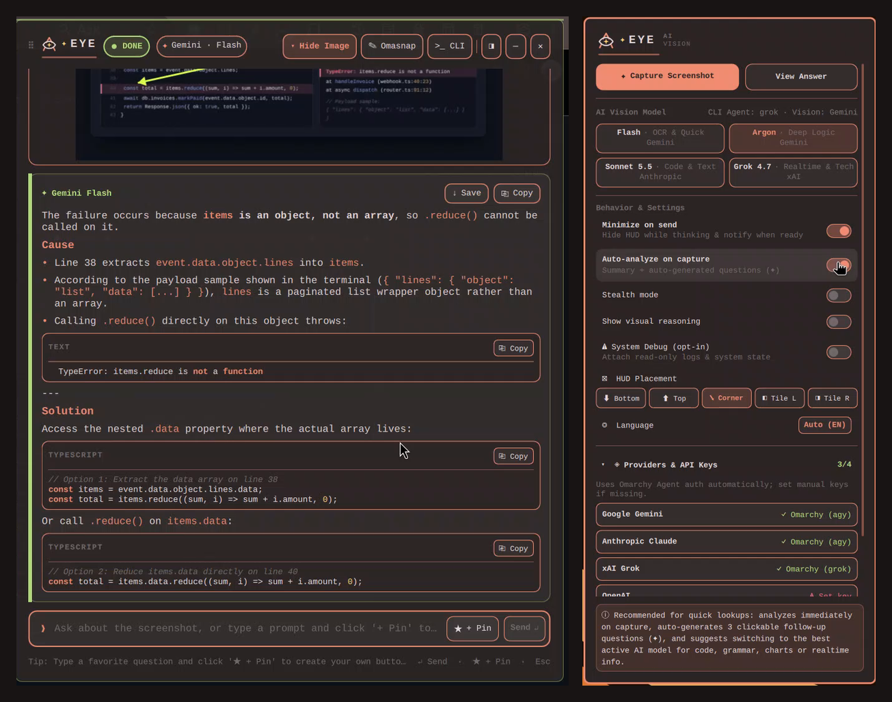
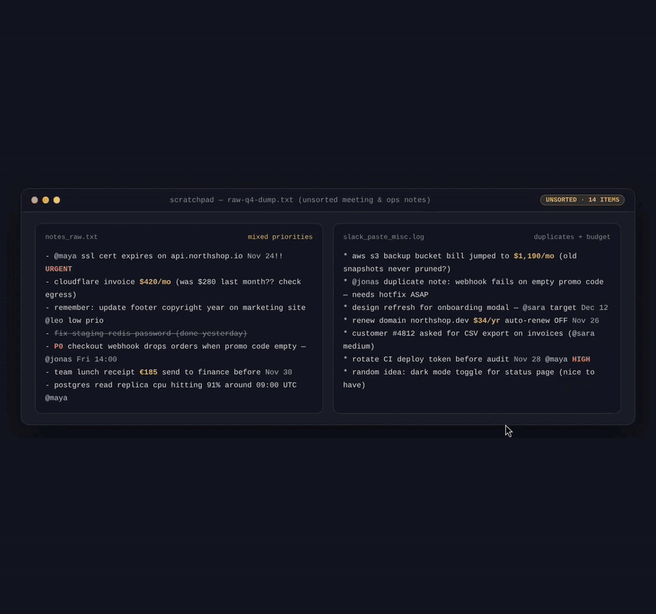
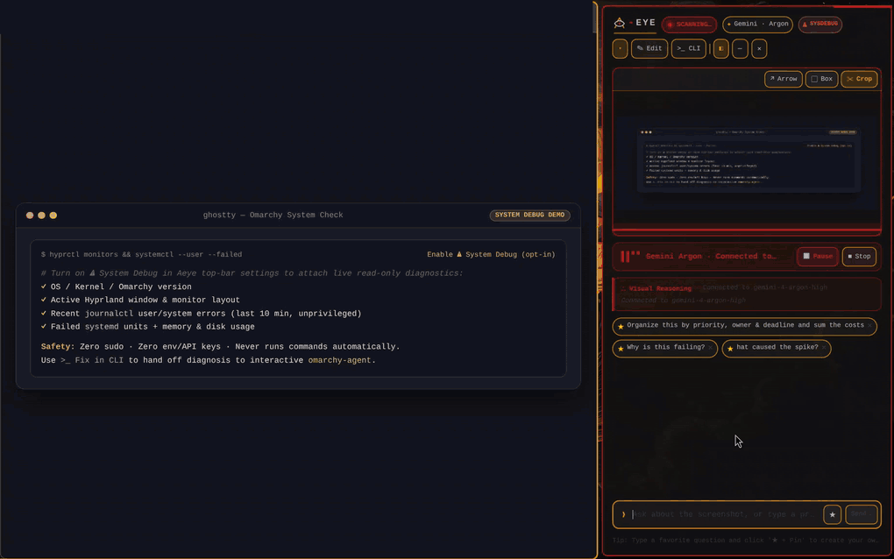
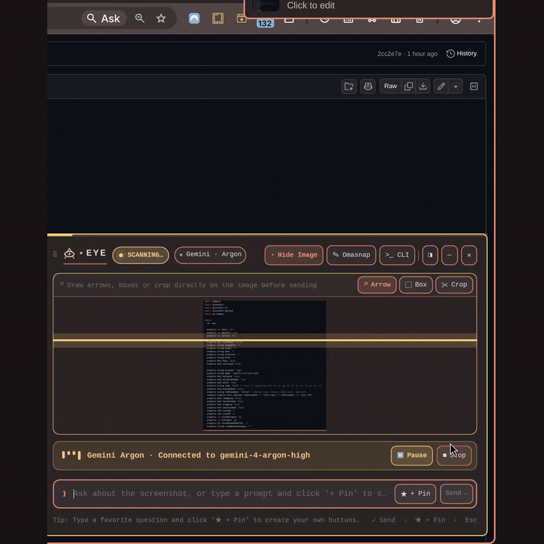
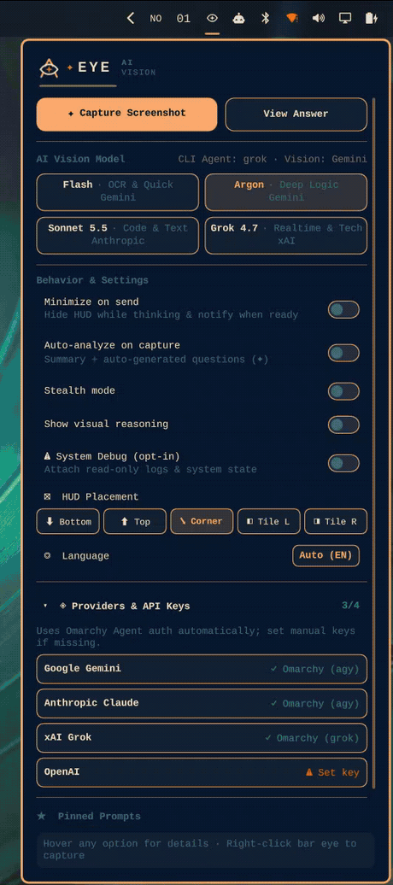
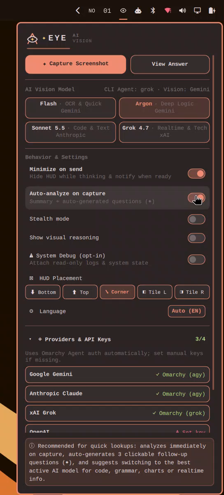

<p align="center">
  <picture>
    <source media="(prefers-color-scheme: dark)" srcset="wordmark-dark.svg" />
    <source media="(prefers-color-scheme: light)" srcset="wordmark-light.svg" />
    
  </picture>
</p>

<p align="center">
  <strong>Capture any region of your screen, point at what matters, and get an AI answer without leaving your workflow.</strong><br />
  A native AI vision HUD, animated top-bar hub, and screenshot assistant built for <a href="https://omarchy.org">Omarchy</a>.
</p>

<p align="center">
  <a href="#install">Install</a> &middot;
  <a href="#how-it-works">How It Works</a> &middot;
  <a href="#showcase">Showcase</a> &middot;
  <a href="#settings--controls">Settings &amp; Controls</a> &middot;
  <a href="#ai-models--privacy">Models &amp; Privacy</a> &middot;
  <a href="#export--system-debug">Save &amp; System Debug</a> &middot;
  <a href="#uninstall">Uninstall</a>
</p>

<p align="center">
  
</p>

---

## Why Aeye

Debugging a cryptic terminal error, reading a dense chart, translating an on-screen paragraph, or reviewing a layout bug normally breaks your flow: take a screenshot, switch to a browser, find the file, upload it, describe which corner you mean, and wait.

Aeye reduces that entire loop to one keystroke — directly inside `omarchy-shell`, styled live from your active Omarchy theme.

### How It Works

1. **Capture** — Right-click the eye icon in your top bar or press <kbd>Super</kbd>+<kbd>Shift</kbd>+<kbd>Print</kbd> to grab any region of your screen.
2. **Point & Ask** — Draw an inline arrow (`↗`), box (`▢`), or crop (`✂`) directly inside the HUD (or open **Omasnap** to redact sensitive text), then type your question and press <kbd>Enter</kbd>.
3. **Keep Working** — The HUD minimizes out of your way while the top-bar icon spins. When the answer arrives, a clickable notification lets you view it or copy it in one click — or dock Aeye as a native Hyprland tiled sidebar right next to your editor.

---

## Install

Install from GitHub using the Omarchy plugin manager:

```sh
omarchy plugin add https://github.com/7eleven77/Aeye.git --enable
```

Update at any time:

```sh
omarchy plugin update io.github.7eleven77.aeye
```

### Optional Global Shortcut

Aeye works immediately from the top bar (**right-click** to capture, **left-click** for settings or a waiting answer). To bind a global keyboard shortcut, add one line to `~/.config/hypr/bindings.lua` (Aeye never modifies Hyprland config files):

```lua
o.bind("SUPER + SHIFT + PRINT", "Aeye", os.getenv("HOME") .. "/.config/omarchy/plugins/io.github.7eleven77.aeye/bin/aeye capture")
```

### Local Development Link

```sh
ln -sfn "$PWD" "$HOME/.config/omarchy/plugins/io.github.7eleven77.aeye"
omarchy plugin enable io.github.7eleven77.aeye
omarchy restart shell
```

---

## Showcase

### 1. Point, Annotate & Fix

Draw an inline arrow (`↗`) directly onto the captured region so the model knows which line or UI element you mean. Answers stream live with structured Markdown, theme-native syntax highlighting, per-block **Copy** buttons, and one-click file export (**`↓ Save`**).

*Active settings: `Minimize on send: OFF` · `Auto-analyze: OFF` · `Model: Gemini Flash`*


---

### 2. Organize Raw Data & Export to `.pdf` (`↓ Save`)

Capture chaotic, unsorted notes, logs, or tables, let Aeye organize them cleanly by priority, owner, deadline, and totals — then click **`↓ Save`** to export directly to a multi-page **`.pdf`** (zero external dependencies), `.md`, `.txt`, `.html`, `.json`, or any custom path.

*Active settings: `All optional toggles OFF` · `Placement: Top` · `Export: .pdf`*



---

### 3. Hyprland Tiling Sidebar (`Tile R`), Auto-Analyze & Opt-in System Debug

Switch HUD placement to **Tile L** or **Tile R** so Hyprland tiles your windows right beside Aeye with zero overlap. Combine **Auto-analyze** (instant summary, 3 clickable `✦` follow-up prompts, and smart model recommendations) with opt-in **`⚠ System Debug`** to correlate on-screen errors against real read-only system state (`journalctl`, failed `systemd` units, `hyprctl`, RAM/disk) — plus **`>_ Fix in CLI`** handoff to `omarchy-agent`.

*Active settings: `Auto-analyze: ON` · `System Debug: ON (read-only)` · `Placement: Tile R`*



---

### 4. Background Flow (Stay in Your Editor)

With **Minimize on send** enabled, pressing <kbd>Enter</kbd> immediately tucks the HUD away so you never stare at a spinner. The top-bar spark pupil animates while the model works, then delivers a clickable **Answer Ready** toast to reopen the answer.

*Active settings: `Minimize on send: ON` · `Auto-analyze: OFF` · `Model: Gemini Argon`*


---

### 5. Privacy Redaction in Omasnap

Need to pixelate tokens, emails, or sensitive code before sending a screenshot to an AI model? Click **Omasnap** (`✎`), redact sensitive regions, and save — Aeye automatically reloads the redacted image before anything leaves your machine.

*Active settings: `Auto-analyze: OFF` (inspect & redact before sending)*



---

### 6. Live Omarchy Theme Integration

Every surface, border, button, status accent, tooltip, wordmark, and syntax token pulls live from your active Omarchy theme (`omarchy theme set ...`) — across dark, warm, emerald, synthwave, and crisp light themes with zero hardcoded UI chrome colors.

<p align="center">
  
</p>

---

## Settings & Controls

Left-click the eye icon in your top bar to open the scrollable Aeye control hub. Hover any toggle or model card to read its full description in the pinned footer bar.

<p align="center">
  
</p>

### Top-Bar Popout Settings

| Setting | What It Does |
|---|---|
| **AI Vision Model** | Switch between active models with role badges (`OCR & Quick`, `Deep Logic`, `Code & Text`, `Realtime & Tech`, `UI & General`). Inactive providers stay hidden until configured. |
| **Minimize on send** | Hide the HUD on <kbd>Enter</kbd>, animate the top-bar icon, and notify when ready. |
| **Auto-analyze on capture** | Immediately summarize new screenshots, generate 3 clickable follow-up prompts (`✦`), and suggest switching to a better model when relevant. |
| **Stealth mode** | Skip opening the HUD completely; analyze in the background and deliver the answer directly via notification. |
| **Show visual reasoning** | Stream live step-by-step reasoning (`∴ Visual Reasoning`) for `agy` and `grok`, and keep the reasoning block above the answer. |
| **System Debug (opt-in)** | Attach a bounded read-only system diagnostics snapshot to help diagnose local crashes, failed services, or Hyprland issues. Off by default. |
| **HUD Placement** | Choose **Bottom**, **Top**, **Corner** (floating, click-through outside the card, freely draggable via `⠿`), or **Tile L / Tile R** (native Hyprland tiled sidebar). |
| **Language** | Auto-detects `$LANG` or cycles live across 12 languages for both UI and AI replies (`EN`, `NO`, `SV`, `DA`, `DE`, `FR`, `ES`, `PT`, `IT`, `PL`, `JA`, `ZH`). |
| **Providers & API Keys** | Inspect detected Omarchy CLI auth (`agy`, `claude`, `grok`) or set manual API keys stored `chmod 600`. |
| **Pinned Prompts** | Save frequently used prompts as one-click chips (`★`). |

### Everyday HUD Controls

| Action | How |
|---|---|
| **Capture a screen region** | Right-click top-bar eye · or <kbd>Super</kbd>+<kbd>Shift</kbd>+<kbd>Print</kbd> |
| **Open settings / waiting answer** | Left-click top-bar eye |
| **Annotate or crop inline** | Use the toolbar above the preview: Arrow (`↗`), Box (`▢`), Crop (`✂`) |
| **Redact sensitive info** | Click **Omasnap** (`✎`), blur/cover secrets, save |
| **Hand off to coding agent** | Click **`>_ CLI`** (or **`>_ Fix in CLI`** in System Debug mode) to open `omarchy-agent` with the image and context |
| **Copy answer or code block** | Click **Copy** on the answer card, click **Copy** on any syntax-highlighted code block, or drag-select text directly |
| **Save answer to file** | Click **`↓ Save`** on the answer card to export to `.txt`, `.md`, `.pdf`, `.html`, `.json`, or any custom path |
| **Move HUD / snap back** | Drag the HUD header (`⠿`) anywhere; double-click the header to reset position |
| **Click into other apps** | Click anywhere outside the floating HUD — clicks pass straight through without closing Aeye |
| **Cancel / close** | <kbd>Esc</kbd> |

---

## AI Models & Privacy

Aeye automatically reuses whatever Omarchy CLI agents you are already signed into (`agy`, `claude`, `grok`). If a provider is not available through a CLI agent, export its environment variable or add a manual API key under **Providers & API Keys**.

| Model | Provider | Best Used For | Auth Sources |
|---|---|---|---|
| **Flash** | Google Gemini | Fast OCR, translations, quick UI lookups & summaries | `agy` · `GEMINI_API_KEY` · Manual key |
| **Argon** | Google Gemini | Dense charts, architecture diagrams, long docs & deep reasoning | `agy` · `GEMINI_API_KEY` · Manual key |
| **Sonnet 5.5** | Anthropic Claude | Code debugging, stacktraces, logs, refactoring & writing | `agy` / `claude` · `ANTHROPIC_API_KEY` · Manual key |
| **Grok 4.7** | xAI | Current/realtime topics, recent tool errors & direct tech checks | `grok` · `XAI_API_KEY` · Manual key |
| **GPT-4o** | OpenAI | All-round vision, UI/UX feedback, tables & JSON extraction | `OPENAI_API_KEY` · Manual key |

- **Isolated working directory:** Every analysis copies only `shot.png` (plus `sysdebug.txt` when System Debug is explicitly enabled) into a private `0700` runtime directory under `$XDG_RUNTIME_DIR` — the model is never launched inside `$HOME`.
- **Key storage:** Manual keys are stored strictly owner-readable (`chmod 600`) in `~/.config/omarchy/aeye-keys.json` and passed to `bin/vision_api.py` via temporary `0600` files, never in command-line arguments or URLs.

---

## Export & System Debug

### Save to Any File (`↓ Save`)

Click **`↓ Save`** on any answer card to open the inline export drawer — no external dialog packages required:

- Pick a quick folder (`~/Documents`, `~/Desktop`, `~/Downloads`, `~/`) or type any path (supports `~/...`, `./...`, or absolute paths and creates missing subdirectories automatically).
- Pick a format preset (`.txt`, `.md`, `.pdf`, `.html`, `.json`) or type any extension you want (`.log`, `.sh`, `.py`, `.csv`, etc.).
- **Zero-dependency PDF export:** `.pdf` generation is built into `bin/export_file.py` using pure Python stdlib (multi-page A4, headings, wrapped lists, monospace code blocks, and Unicode fallback normalization) — no `pandoc` or `weasyprint` needed.
- Writes atomically and blocks protected system paths (`/etc`, `/usr`, `/boot`, `/sys`, `/proc`, `/dev`).

### Opt-in System Debug

> [!WARNING]
> **System Debug is OFF by default.** When you explicitly enable **System Debug** in the top-bar settings popout, Aeye attaches a bounded (~8 KB) **read-only** diagnostic snapshot alongside your screenshot so the AI can correlate on-screen errors with real system state:
> - OS, kernel, and Omarchy version
> - Active Hyprland window metadata and monitor layout (`hyprctl`)
> - Recent user/system error entries from the last 10 minutes (`journalctl`, unprivileged)
> - Failed `systemd` units (`systemctl --failed`)
> - Memory and disk summary (`free -h`, `df -h / $HOME`)
>
> **Safety guarantees:** Aeye never invokes `sudo` or `pkexec`, never dumps environment variables, never reads API keys or `~/.config`, and **never runs AI-suggested commands automatically**. A `⚠ SYSDEBUG` indicator stays visible in the HUD header whenever active (click it anytime to disable). If you want an agent to apply a fix interactively, click **`>_ Fix in CLI`** to review and approve changes inside `omarchy-agent`.

---

## Requirements & Tests

- **Omarchy:** `omarchy-shell`, `omarchy-notification-send`, `omarchy-agent`, `omasnap`
- **System tools:** `imagemagick` (`magick`), `wl-clipboard` (`wl-copy`), `inotify-tools` (`inotifywait`), `jq`, `python3`

Run the offline smoke, export, security, and Omarchy compliance test suite:

```sh
./tests/smoke.sh
```

---

## Uninstall

Remove cleanly with the Omarchy plugin manager:

```sh
omarchy plugin remove io.github.7eleven77.aeye
```

Optionally remove local settings and manual API keys:

```sh
rm -f ~/.config/omarchy/aeye.json ~/.config/omarchy/aeye-keys.json
```

---

## License

MIT License — see [LICENSE](LICENSE).
