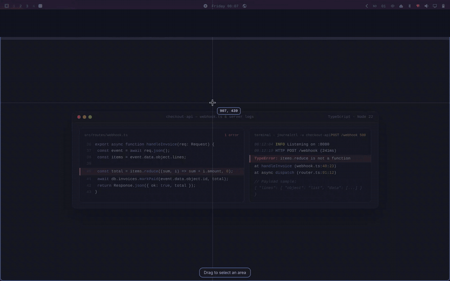
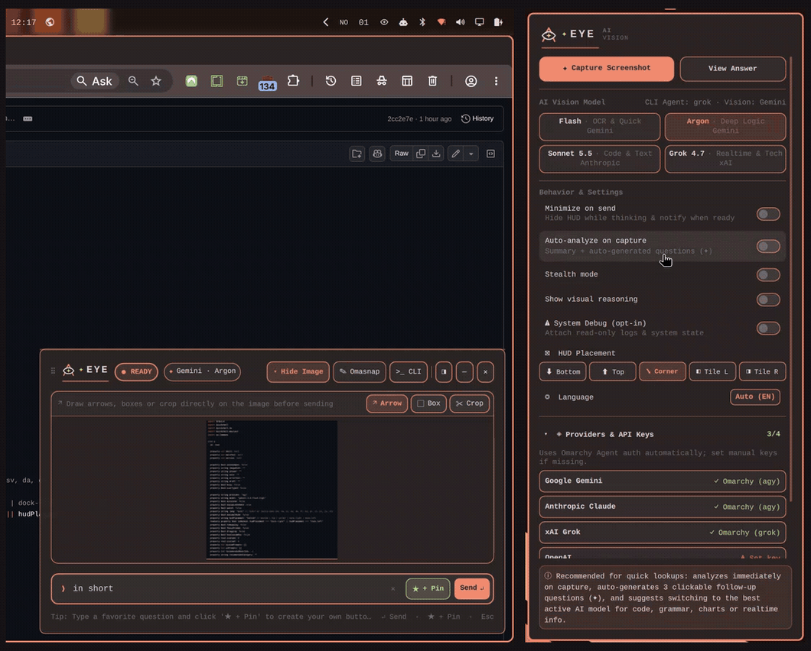
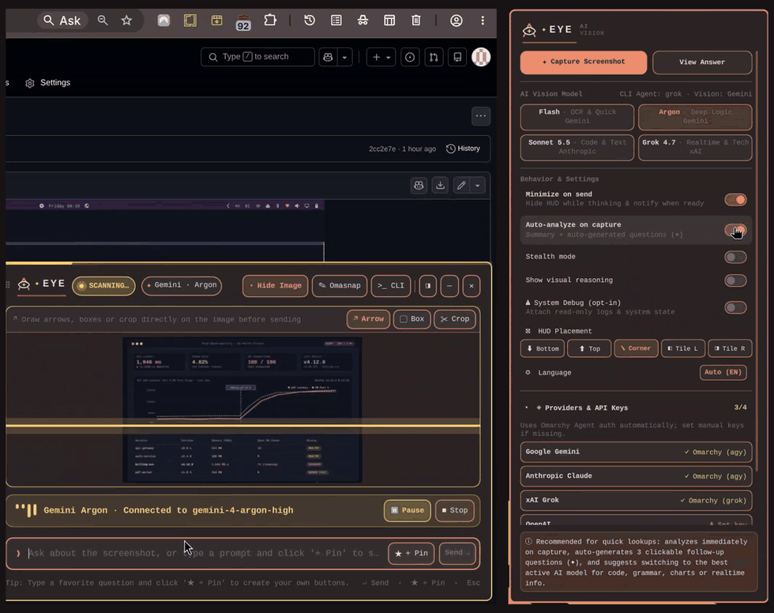
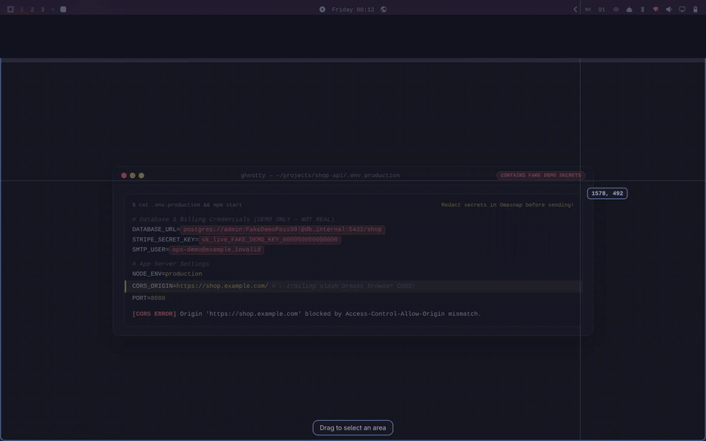
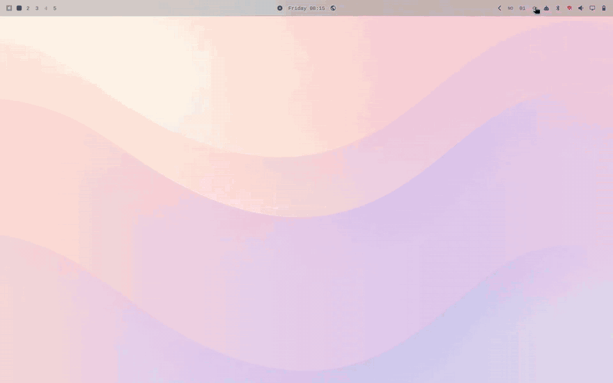

<p align="center">
  <picture>
    <source media="(prefers-color-scheme: dark)" srcset="wordmark-dark.svg" />
    <source media="(prefers-color-scheme: light)" srcset="wordmark-light.svg" />
    
  </picture>
</p>

<p align="center">
  <strong>Point at anything on your screen, ask a question, and keep working while AI reads it for you.</strong><br />
  A native screenshot &amp; AI vision plugin built for <a href="https://omarchy.org">Omarchy</a> and Quickshell.
</p>

---

## Why Aeye?

When you hit a cryptic terminal error, a dense chart, an untranslated paragraph, or a weird layout bug, the usual routine kills your flow: take a screenshot, open a browser, find the file, upload it, explain which corner of the screen you mean, and sit there waiting for a reply.

**Aeye** shrinks that entire loop into one motion:

1. **Grab a region** — right-click the eye icon in your top bar (or press `Super+Shift+Print`).
2. **Point & ask** — optionally draw an arrow (`↗`), box (`▢`), crop (`✂`), or redact secrets in **Omasnap** (`✎`), then hit `Enter`.
3. **Stay in flow** — the HUD tucks itself away while the **Spark Pupil** icon spins in your top bar. When the answer lands, you get a clickable notification (**View Answer** / **Copy**) and a green ready dot in the bar.

Everything — backgrounds, borders, tooltips, accents, and status colors — pulls live from your active Omarchy theme (`omarchy theme set ...`).

---

## Showcase

| Workflow | Preview |
|---|---|
| **1. Point & Debug (`↗` Arrow + Fix)** |  |
| **2. Background Flow (Top-Bar Spin + Toast)** |  |
| **3. Auto-Analyze + Smart Model Tip** |  |
| **4. Privacy Redaction in Omasnap** |  |
| **5. 100% Live Omarchy Theme Switching** |  |

---

## Quick Start

Install via the Omarchy plugin manager:

```sh
omarchy plugin add https://github.com/7eleven77/omarchy-aeye.git --enable
```

Or link a local clone if you want to hack on it:

```sh
ln -sfn "$PWD" "$HOME/.config/omarchy/plugins/io.github.7eleven77.aeye"
omarchy plugin enable io.github.7eleven77.aeye
omarchy restart shell
```

### Optional Global Shortcut

Aeye works right away from the top bar (**right-click** the eye icon to capture, **left-click** for settings or to open a waiting answer). If you also want a keyboard shortcut, add this line to `~/.config/hypr/bindings.lua`:

```lua
o.bind("SUPER + SHIFT + PRINT", "Aeye", os.getenv("HOME") .. "/.config/omarchy/plugins/io.github.7eleven77.aeye/bin/aeye capture")
```

### Removal

Uninstall cleanly with the Omarchy plugin manager:

```sh
omarchy plugin remove io.github.7eleven77.aeye
```

If you also added the optional Hyprland shortcut or want to clear local settings and manual API keys:

```sh
rm -f ~/.config/omarchy/aeye.json ~/.config/omarchy/aeye-keys.json
```

---

## Everyday Controls

| Action | How |
|---|---|
| **Capture a screen region** | Right-click the top-bar eye · or `Super+Shift+Print` |
| **Open settings / waiting answer** | Left-click the top-bar eye |
| **Annotate or crop inline** | Click **Image** in the HUD → Arrow (`↗`), Box (`▢`), Crop (`✂`) |
| **Redact sensitive info** | Click **Omasnap** (`✎`), blur/cover secrets, save — Aeye reloads automatically |
| **Hand off to coding agent** | Click **`>_ CLI`** in the HUD to drop the screenshot & context straight into `omarchy-agent` |
| **Pin favorite prompts** | Type a prompt you reuse often and click **`★ + Pin`** |
| **Copy or select answer** | Full Markdown + theme-native syntax-highlighted code blocks with per-block **Copy** buttons, or drag-select any line directly in the HUD |
| **Live visual reasoning** | Toggle **Show visual reasoning** in the top-bar popout to stream visual reasoning steps in real time (`agy` & `grok`) |
| **Move HUD / Hyprland Tiling** | Drag the HUD header (`⠿`) anywhere (double-click to snap back) · or choose **Bottom / Top / Corner / Tile L / Tile R** in the top-bar popout (`Tile L/R` reserves space inside Hyprland tiling!) |
| **Interact with other apps** | Click anywhere outside the HUD — clicks pass straight through without closing Aeye |
| **Cancel / close** | `Esc` |

---

## AI Models & Credentials

Aeye automatically reuses whatever Omarchy CLI agents you are already signed into (`agy`, `claude`, `grok`). If a provider isn't active via CLI, you can either export its environment variable or paste an API key directly inside **🔑 Providers & API Keys** in the top-bar popout.

Only **active** providers appear in the model selector — unconfigured providers stay neatly tucked inside **Providers & API Keys** until you enable them.

| Model | Provider | Best Used For | Auth Source |
|---|---|---|---|
| **Flash** | Google Gemini | Fast OCR, translations, quick UI lookups & summaries | `agy` · `GEMINI_API_KEY` · Manual key |
| **Argon** | Google Gemini | Complex charts, architecture diagrams, dense docs & reasoning | `agy` · `GEMINI_API_KEY` · Manual key |
| **Sonnet 5.5** | Anthropic Claude | Code debugging, stacktraces, logs, refactoring & grammar/writing | `agy` / `claude` · `ANTHROPIC_API_KEY` · Manual key |
| **Grok 4.7** | xAI | Current/realtime info, brand-new tool errors & blunt tech checks | `grok` · `XAI_API_KEY` · Manual key |
| **GPT-4o** | OpenAI | All-round vision, UI/UX feedback, tables/JSON extraction | `OPENAI_API_KEY` · Manual key |

> **Auto-analyze tip:** Turn on **Auto-analyze on capture** if you want Aeye to immediately summarize the screenshot, generate 3 clickable follow-up questions (`✦`), and suggest switching to a better active model when it spots code, grammar, live info, or complex diagrams.

> **Key security:** Manual keys are stored strictly owner-readable (`chmod 600`) in `~/.config/omarchy/aeye-keys.json` and passed to `bin/vision_api.py` via temporary `0600` files — never in command-line arguments or URLs.

---

## Requirements & Tests

- **Omarchy:** `omarchy-shell`, `omarchy-notification-send`, `omarchy-agent`, `omasnap`
- **System tools:** `imagemagick` (`magick`), `wl-clipboard` (`wl-copy`), `inotify-tools` (`inotifywait`), `jq`, `python3`
- **Languages:** Auto-detects `$LANG` or switches live across 12 languages (`EN`, `NO`, `SV`, `DA`, `DE`, `FR`, `ES`, `PT`, `IT`, `PL`, `JA`, `ZH`).

Run the offline smoke & compliance test suite anytime:

```sh
./tests/smoke.sh
```

---

## License

Licensed under the [MIT License](LICENSE) — 100% legally solid, with a [seriously silly human translation](LICENSE-HUMAN.md) for mortals.
